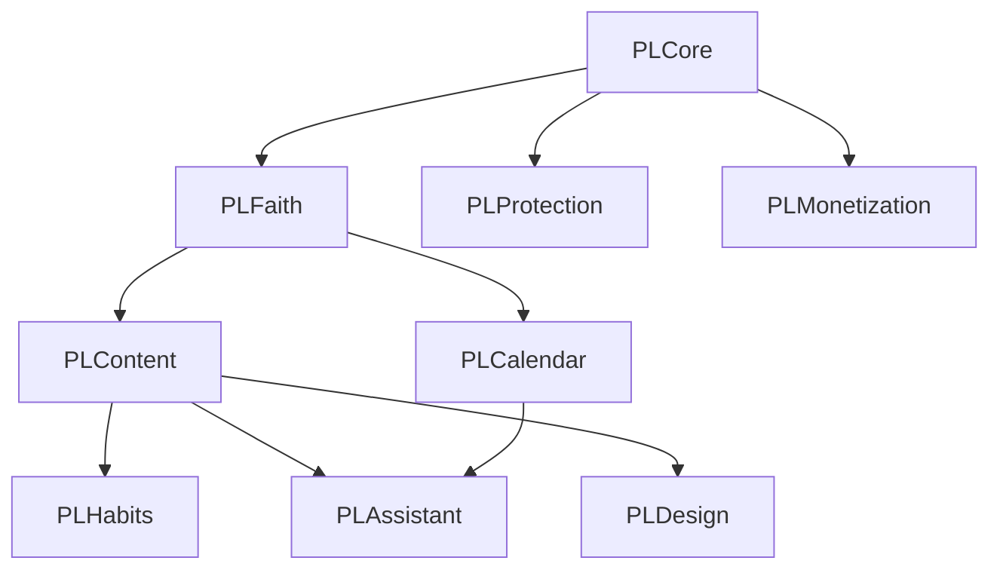

# Architecture

## 1. Shape of the system

```
pray/
├─ PrayerLock.xcodeproj          Xcode project (synchronized folders; shared scheme "PrayerLock")
├─ Config/                       xcconfig: Shared / Debug / Release (+ git-ignored Secrets)
├─ App/                          iOS app target (SwiftUI) — UI + composition root only
├─ Extensions/
│  ├─ ShieldConfiguration/       shield appearance (ManagedSettingsUI)
│  ├─ ShieldAction/              shield buttons → hand-off to app (ManagedSettings)
│  └─ ActivityMonitor/           re-shield after unlock windows (DeviceActivity)
├─ UITests/                      XCUITest smoke tests
├─ Packages/PrayerLockKit/       all product logic (Swift package, 9 modules, unit tests)
└─ docs/
```

Four processes share one App Group: the app and three extensions. Extensions are tiny and
memory-constrained; they link only `PLCore` + `PLProtection` (+ `PLBrand` for the shield's
colors). None links SwiftUI (verified with `otool -L`; each appex ≈ 0.7 MB).

## 2. Modules (Packages/PrayerLockKit)



| Module | Responsibility | Platform |
|---|---|---|
| `PLCore` | typed identifiers, `CivilDate` (exact day math), file store with Data Protection + file coordination, key-value store, logging, build configuration | any |
| `PLFaith` | religion-agnostic taxonomy: faiths → traditions → (optional) focuses → sources → editions (with licence status); `SpiritualProfile`; `FaithRegistry` (data: `faiths.json`) | any |
| `PLContent` | `ContentItem` built from provenance-labelled `ContentSegment`s; taxonomy (themes, mood→theme map); `CatalogValidator`; `ContentPolicy` (dev vs release); deterministic `ContentSelector` | any |
| `PLCalendar` | rule-based observances (Gregorian, Julian, Easter computus, Hijri via Umm al-Qura, sourced tables), weekly observances, opt-in devotional associations | any |
| `PLHabits` | `PrayerSession`, repositories, `HabitCalculator` (streak, consistency, totals, themes, milestones) | any |
| `PLProtection` | pure & unit-tested: `ProtectionEngine` (orchestration), `RelockService` (shared with the monitor extension), `ProtectionPlatform` protocol, settings, grants, `UnlockPlanner`, shield requests/copy, event log, status. iOS-only (`#if os(iOS)`): `ScreenTimePlatform` adapter (`ScreenTimeProtectionController = ProtectionEngine<ScreenTimePlatform>`) | any + iOS |
| `PLBrand` | color tokens only (UIKit); lets the sandboxed shield extension avoid SwiftUI | any |
| `PLMonetization` | product config (no prices), `SubscriptionState`, `EntitlementResolver`, StoreKit 2 service, `UnavailablePurchaseService` | any |
| `PLAssistant` | AI pipeline: safety router → intent → faith context → retrieval → generation (protocol) → validation | any |
| `PLDesign` | design tokens (palette, type scale, spacing), buttons, provenance label, segment renderer | SwiftUI |

Rules: lower modules never import higher ones; domain modules contain identifiers, not UI
strings (display strings live in the app's String Catalog); every public type is `Sendable`
(Swift 6 strict concurrency, `SWIFT_STRICT_CONCURRENCY = complete`).

## 3. App layer

- **Composition root** — `AppEnvironment` builds every concrete service once (bundled data,
  stores, Screen Time controller, purchase service, assistant pipeline). With `-PLUITesting`
  it swaps in throwaway storage.
- **State** — one `@Observable @MainActor AppModel` coordinates package services and holds UI
  state. Business rules stay in the package; the model is glue.
- **Feature views** — `Features/{Onboarding,Today,Moment,Protection,Journey,Settings}`.

### Navigation

```
Launch ─┬─ not onboarded → Onboarding: welcome → faith → [tradition] → [focus] → personalize
        │                              → privacy → protection (Screen Time + picker) → notifications
        └─ onboarded → TabView
              ├─ Today        greeting · observances · check-in · "Begin a moment"
              ├─ Protection   authorization · app picker · on/off · unlock duration · limits
              ├─ Journey      consistency · streak · totals · themes · recent moments
              └─ Settings     practice · privacy (delete all) · premium · sources · about

Moment (full-screen cover) ← "Begin a moment" | shield hand-off (notification tap or
                              openParentalControlsApp) — arrival → [check-in] → reflection
                              → intention → complete (grant access)
```
Steps in brackets are skipped when they don't apply (e.g. Islam has no focus step). The
moment is not a tab: it is an interruption, presented only when invited.

## 4. The lock loop

Design (implemented, unit-tested with a fake platform, compiled for iOS — **not yet observed
on a physical iPhone**; see docs/11 and docs/13):

```mermaid
sequenceDiagram
  participant U as User
  participant S as System shield
  participant C as ShieldConfiguration ext
  participant A as ShieldAction ext
  participant P as Prayer Lock app
  participant M as ActivityMonitor ext
  U->>S: opens protected app
  S->>C: configuration(shielding:)
  C-->>S: invitation copy (from App Group)
  U->>S: taps "Begin"
  S->>A: handle(.primaryButtonPressed)
  A->>A: record ShieldRequest (App Group) + post local notification
  A-->>S: .openParentalControlsApp (iOS 26.5+, flagged) / .defer
  P->>P: becomes active → takes pending request → presents Moment
  U->>P: completes moment
  P->>P: schedule relock (DeviceActivity) THEN clear shields; record session
  U->>U: switches back to the app manually
  M->>M: intervalDidEnd / eventDidReachThreshold for current grant
  M->>M: re-apply shields (stale grant callbacks ignored)
```

## 5. Cross-cutting concerns

| Concern | Approach |
|---|---|
| Errors | Typed errors per module (`StorageError`, `ProtectionError`, `PurchaseError`, `GenerationError`, …). UI shows `AppAlert`s with plain language; nothing fails silently — failures are logged. Bundled-data failure shows a launch error screen instead of crashing. |
| Logging | `os.Logger` via `Log.logger(category)`; subsystem = bundle ID. Policy: log events and IDs, never prayer text, moods, names. |
| Configuration | `Config/*.xcconfig` → Info.plist keys (`PLEnvironment`, `PLAppGroupIdentifier`, `PLAssistantEndpoint`, `PLSubscriptionGroupID`) → `AppConfiguration`. Unresolved `$(…)` values are treated as missing. |
| Secrets | None in the app or repo. `Config/Secrets.xcconfig` is git-ignored and holds only identifiers (team ID, bundle prefix). Model-provider keys belong on a server proxy (see 05). |
| Offline | Designed to work offline: content, calendar, habits, and protection logic are on-device (offline behaviour of protection not yet verified on a device). StoreKit caches entitlements; `EntitlementResolver` checks expiry so stale caches can't grant premium forever. |
| Localization | String Catalog (`Localizable.xcstrings`, populated by Xcode at build); content text is `LocalizedText` in data; RTL handled for Arabic/Hebrew segments; Dynamic Type everywhere. |
| Accessibility | Dynamic Type text styles only; ≥44pt targets (buttons 50pt); VoiceOver labels on icon buttons, combined elements for content segments, selection traits on chips; Reduce Motion disables breathing animation and slide transitions. |
| Concurrency | Swift 6 language mode, complete checking; framework types from Screen Time imported `@preconcurrency`. |
| Extension memory | Extensions link the minimum modules and read only small App Group values. |

## 6. Future-proofing

- **More faiths** — add to `faiths.json`, content packs, and observance rules; no code changes.
- **Android** — the package's pure modules define the behaviour and data formats (JSON
  catalog, rules); an Android app would re-implement the platform layer (Usage Access /
  Accessibility-based blocking are very different and need their own research).
- **Content delivery** — `ContentCatalog` can load signed, versioned packs downloaded at runtime
  through the same validator and policy.
